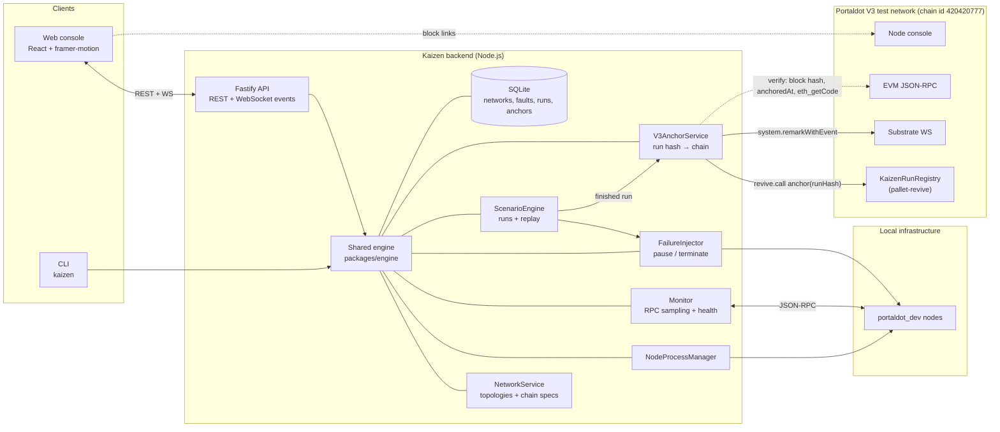

# Kaizen
Monitoring tells you a node is down. Kaizen proves it comes back, and makes that proof worth stake.

Kaizen is a disaster-simulation engine that breaks Portaldot validators on purpose and proves on-chain that they recover.

Kaizen is a proof-of-resilience platform for Portaldot validators. It runs controlled drills against disposable test networks, records the observed operations and evidence, and supports independently verifiable certificates anchored to the Portaldot V3 test network.

[](https://kaizen-live.vercel.app)

## The problem

| Pillar | What it means | Status |
|---|---|---|
| **1. A future block hash schedules the drill** | Drill timing and fault choice are derived from the hash of a block that did not exist when the drill was committed (commit-reveal), so a drill cannot be pre-staged or cherry-picked. | **Roadmap** — specified in [docs/RESILIENCE_SCORE.md §7.1](docs/RESILIENCE_SCORE.md); not built. Today drills are operator-triggered. |
| **2. Recovery is proven from what the chain records** | Recovery = GRANDPA finality advancing past where it stalled, read from block hashes any verifier can re-fetch; BABE authorship by the validator's own keys before/after the fault is the next step. Operator-measured timings are weighted least. | **Partly implemented** — finalized/best heads (number + hash) are captured before, during and after the fault and re-checked against the chain by `kaizen verify-certificate`; recovery is only declared when finality advances. **Verified live** on x86_64 CI ([run 40042905143](https://github.com/Shaydez-Defi/kaizen/actions/runs/40042905143)): pause drill on a real two-node `portaldot_dev` network, 11 captured hashes re-fetched → `verified`; network stopped → `unverifiable: network offline` ([evidence](docs/evidence/resilience/)). BABE authorship and evidence-class weighting (self-reports weighted least): **roadmap** (§7.2–7.3) — the v1 score still gives the measured recovery time the largest weight. |
| **3. A signed certificate under an open attestation spec** | SHA-256 fingerprint over canonical JSON of the run record + chain evidence, signed with the operator's sr25519 key; open score formula with worked examples. | **Implemented** — `kaizen certify` / `score` / `verify-certificate`, `/api/resilience/*`, spec in [docs/RESILIENCE_SCORE.md](docs/RESILIENCE_SCORE.md); unit-tested (engine 50, CLI 3, API 4) and exercised live in the same CI run (dev-key certificate). `KaizenResilienceRegistry` is **deployed on the V3 test network** at `0x8ec2b52a5e407926309f983f6e7d019d66da764a` (block 167466) and holds that CI certificate with its v1 score, read back with `getScore` → 35/100, 1 certificate ([evidence](docs/evidence/v3-resilience-registry-v1.json)). The certificate is DEV-key signed and came from a local CI network, not from a drill on V3. |

## How it works

```bash
KAIZEN_RESILIENCE_EVIDENCE=1 kaizen run execute <scenarioId> --network <net>   # capture
kaizen certify <runId> --dev-key        # or KAIZEN_RESILIENCE_SIGNER_SURI / _FILE (key outside the repo)
kaizen score <validator>                # 0–100 from certified runs
kaizen score <validator> --v2 [--verify-chain]  # v2: weight runs by evidence class (signed-local 0.7, chain-verified 1)
kaizen verify-certificate <fingerprint> # verified | mismatch | unverifiable (network offline)
kaizen export-certificate <fingerprint> --out cert.bundle.json   # certificate + run in one portable file
kaizen verify-certificate --bundle cert.bundle.json --rpc <http-rpc-url>  # verify from the file alone
```

`--dev-key` uses the public `//Alice` key and is accepted only for local
designated-test networks; such certificates are labelled "DEV KEY —
integrity only, not identity".

```
CREATE → MONITOR → BREAK → DIAGNOSE → RECOVER → DEPLOY
                                 └──→ CERTIFY → SCORE → ANCHOR ON PORTALDOT V3
```

Nothing in the UI is mocked: every number comes from real RPC, real process
state, recorded history, or the V3 chain. Features that are not built yet are
shown disabled and labelled with their phase — never simulated.

## Current status (2026-10-21, Hacker House Week 2)

| Area | Status |
|---|---|
| Node lifecycle (binary download + SHA-256, spawn/stop/purge, ports, logs) | **Verified** on the real binary (Phase 1) |
| Topologies: single, two-node, four-validator, validator + full node, custom | **Verified** (Phase 2A) |
| Live monitoring (peers, heads, finality, sync, health state machine, WS events) | **Verified** (Phase 2A/2B) |
| Failure Lab engine: `pause` (SIGSTOP/SIGCONT), `terminate` (stop + restore), dry run, test-network gate, audit log | **Verified** live (Phase 3B) |
| Scenarios: authoring, validation, execution with evidence, cancel (cross-process), replay | **Verified** live (Phase 3C–3F) |
| CLI for scenarios/runs | **Verified** live (T-3.6A) |
| **Portaldot V3 connectivity probe** (Substrate WS, EVM RPC, node console) | **Verified** live (T-8.1) |
| **Portaldot V3 run anchoring** (KaizenRunRegistry contract + remark, verify) | **Verified** live on the V3 test network (T-8.2) |
| **Proof-of-Resilience** (chain evidence, signed certificates, verify, score v1, registry contract) | See the pillar table above (Phase 9, T-9.1–T-9.5, T-9.8 on V3) |
| Web console (new design): Overview, Networks, node drawer, Failure Lab, Scenarios, Incidents evidence, Deployments, Validators, V3, Settings | **Implemented** — 61 jsdom tests; rendered in headless Chromium over fixture API data (T-3.6C); not yet driven against a live network (RSK-23) |
| `kaizen up` (setup if needed → preset network → health-gated start → endpoints) | **Implemented** — 5 unit tests with a fake engine; live run needs an x86_64 host (T-3.6C) |
| `peer-disconnect` / `partition` faults | Blocked by the engine with typed reasons (R-22) — shown disabled |
| Incident detection & correlation | Phase 4 — not built |
| Validator operations (staking, session keys) | Phase 5 — not built |
| Docker / Kubernetes (Helm) deployment | Phase 6 — not built (planned scope) |

Full detail: [docs/IMPLEMENTATION_PLAN.md](docs/IMPLEMENTATION_PLAN.md) ·
[docs/PROGRESS.md](docs/PROGRESS.md) · [docs/PHASE_REPORT.md](docs/PHASE_REPORT.md).

## Screenshots

Rendered from the real console code in headless Chromium (1440 px) with the
dev-only harness `apps/web/scripts/screenshots.mjs`, which answers `/api/*`
and the event WebSocket with **fixture data** (a four-validator
`meridian-test` network). They show the UI, not a live network run.

| | |
|---|---|
|  |  |
|  |  |
|  |  |

Full landing page: [docs/assets/ui/landing-full.webp](docs/assets/ui/landing-full.webp).

## Architecture



## Portaldot V3 integration

Kaizen treats a finished Failure Lab run as evidence worth proving:

1. **Fingerprint** — `computeRunHash` = SHA-256 of the canonical JSON of the
   persisted run record (steps, observations, cleanup, outcome).
2. **Anchor** — written to the V3 test network either through the
   **KaizenRunRegistry** Solidity contract (`contracts/KaizenRunRegistry.sol`,
   EVM bytecode on pallet-revive: `anchor(bytes32 runHash, string meta)`
   emitting `RunAnchored`) or, when chosen explicitly, via
   `system.remarkWithEvent("kaizen:v1:<runHash>:<runId>")` (DEC-027).
   Writes happen only on an explicit, confirmed request, are signed by an
   operator key read from `KAIZEN_V3_SIGNER_SURI` only, and are dry-run
   first; records are persisted before submission and a submission without
   on-chain evidence is recorded as `failed`, never as anchored (DEC-026).
3. **Verify** — recompute the hash from the stored run and re-read the chain:
   block hash at the recorded height, registry `anchoredAt(runHash)`,
   `eth_getCode` for the registry, or the remark text.

Surfaces: CLI `kaizen v3 probe | status | hash | anchor | anchors | verify`
(plus operator-only `deploy-registry` / `import-deployment`, and for Proof-of-Resilience `deploy-resilience-registry` / `anchor-certificate <file> --score <n>` / `resilience-score <validator>`), API
`/api/v3/probe|status|anchors|runs/:runId/hash`, `POST /api/v3/anchors`,
`POST /api/v3/anchors/:id/verify`, and the console's **Portaldot V3** screen.

Endpoints (overridable via `KAIZEN_V3_*`): `wss://test-node-v3.portaldot.dev`,
`https://test-evm-rpc-v3.portaldot.dev`, `https://node-console.portaldot.dev`.

### Testnet evidence

Chain **PortaldotV3 Test**, EVM chain id **420420777**, genesis
`0xd4f9acbcf7f52388d8b095abe3c198d19fc510e0343e643e87cfbccb155283bd`.
Signer (public): `5HSwNUrjU8VqBfdjJdmGdEYig96V1uR6qySiKTZF6eoBd32o`.

| What | Block | Transaction hash | Details |
|---|---|---|---|
| KaizenRunRegistry deployed | [136822](https://node-console.portaldot.dev/?rpc=wss%3A%2F%2Ftest-node-v3.portaldot.dev#/explorer/query/0x567175bb40b891a5103e00c74b1b15b227a67f3da1aa93ef8264a09f580ecef2) | `0x2fa1c5ae2de79d71ca663d7e7050cc9995e4803b234ade6dd916bc3a8d5eff30` | contract `0x08fdadd1ebe16234c03b723255cc12fd98a5ef07` |
| Contract anchor — run `run-mvim409r-32019a7e` | [136899](https://node-console.portaldot.dev/?rpc=wss%3A%2F%2Ftest-node-v3.portaldot.dev#/explorer/query/0x2efd3f718fd67b044dd23fc7c2135c4cd69c53f6f5dd99170a9fc5e073eb0c69) | `0xa06abaa085c59486bd2a8d8e4d593b30a9a6e521c7908c6de4b3bdbb70f8c5b7` | `pause-alice-drill`, run hash `0x24c2d025…bf1214`, finalized |
| Contract anchor — run `run-mvim7jct-5df7ea0f` | [136919](https://node-console.portaldot.dev/?rpc=wss%3A%2F%2Ftest-node-v3.portaldot.dev#/explorer/query/0x4f8d4617013382d0c07acb54c7a25ae10a737ed4077ed3383e14b7526b2f7a56) | `0x8ae9cfc07d559c9dc058472869ae6daa1c364d8965f597704bcc44893abd4df9` | `terminate-bob-drill`, finalized |
| Remark anchor — run `run-mvim409r-32019a7e` | [136940](https://node-console.portaldot.dev/?rpc=wss%3A%2F%2Ftest-node-v3.portaldot.dev#/explorer/query/0x9a2b7b6d5522e54e0ec44d486f5e8b5d8e1c075797bde732209b2fa4267fa6f3) | `0xa9b15505f07d72738159fb24af61f9959319f7e241125c4b1e82d1c8ab1173ff` | `pause-alice-drill` (same run as 136899), finalized |
| Remark anchor — run `run-mvim9v7m-875cdcaa` | [136947](https://node-console.portaldot.dev/?rpc=wss%3A%2F%2Ftest-node-v3.portaldot.dev#/explorer/query/0x739af302a1aab00977f1af04c619a8cc5ea97d91e8c36a00c1f0e5699fe9e38a) | `0x84027d2397efce0930e1a5abd49b77a741a8820f4373ebb8dc9c97f7fd774f49` | `pause-alice-drill` (replay), run hash `0x26ebf52f…edd9c`, finalized |
| KaizenResilienceRegistry deployed | [167466](https://node-console.portaldot.dev/?rpc=wss%3A%2F%2Ftest-node-v3.portaldot.dev#/explorer/query/0x78c5ca8715d548a0e1d9a31381d117645fa65ce6d7affddebfe00364a8c5b859) | `0x88bdae46743bbf059150a16d705ebe955dd3b91a8b8b34eb91d7ecb9cc0dd9e9` | contract `0x8ec2b52a5e407926309f983f6e7d019d66da764a`; on-chain code = committed artifact; finalized |
| ink! resilience registry twin deployed | [207418](https://node-console.portaldot.dev/?rpc=wss%3A%2F%2Ftest-node-v3.portaldot.dev) | `0x0481783338d70d8af5c1beac7c368349d22cad61d7305e0d16c7a3e2a2cfe75b` | contract `5DZ2aWJK6gupeHNj9FhAuHWZjtTMirFes75uXeZEWa2ipkiw`; one anchor at block 207421 cost 1.416 tPOT (vs 7.74 on the EVM lite registry); `getScore` → (35, 207421, 1); evidence [docs/evidence/v3-ink-registry.json](docs/evidence/v3-ink-registry.json) |
| Resilience certificate recorded | [167478](https://node-console.portaldot.dev/?rpc=wss%3A%2F%2Ftest-node-v3.portaldot.dev#/explorer/query/0xfbe64ed2d727a54c1cf6cee6b512b2cf99795afa74707397d1350cd7f4bc73f6) | `0x905f964cb7ca45c9d1ed630084595b7b8b934c0288216fdc5252436e0d86fee3` | `record()` of certificate `0x517b2ffb…1e2e33` (CI run 40042905143, validator `res-it-bob`, DEV key), score 35; `CertificateRecorded` emitted; finalized |

**Proof-of-Resilience on V3 (2026-10-24).** `getScore(validatorKey)` on the
resilience registry returns `(35, 1792801920, 1)`: score 35, certified at the
block timestamp of 167478, one certificate. It reads the same through the
Substrate runtime API (`kaizen v3 resilience-score res-it-bob --registry …`)
and through `eth_call` on the EVM RPC. Re-submitting the same certificate is
refused before anything is paid (`V3_ALREADY_ANCHORED`). What this proves:
a signed CI drill certificate is stored on V3 and anyone can read it back. What it
does not prove: the drill ran on V3, operator identity (DEV key), or an
unpredictable drill schedule (still roadmap, T-9.6). Full record:
[docs/evidence/v3-resilience-registry-v1.json](docs/evidence/v3-resilience-registry-v1.json).

All four run anchors were re-verified on chain on 2026-10-21 (`verified`: hash and
block hash match; contract anchors also show registry code present and
`anchoredAt`). The anchored runs were real `pause` / `terminate` Failure Lab
runs on a local two-node `portaldot_dev` network; the exact run records are
in [docs/evidence/runs/](docs/evidence/runs/), the anchor records (including
two honestly recorded failed attempts) in
[docs/evidence/v3-anchors.json](docs/evidence/v3-anchors.json), and a unit
test recomputes every anchored hash from them.


Costs observed on the V3 test network: ≈85 tPOT to deploy the run registry,
≈4 tPOT storage deposit per run anchor, ≈0.02 tPOT per remark; ≈261.7 tPOT to
deploy the resilience registry (195.2 code deposit + 66.2 storage deposit +
0.33 fee) and ≈30.8 tPOT per certificate `record()` (30.73 storage deposit +
0.06 fee). Deposits are held, not burned (RSK-30).

## Quickstart

Requirements: Node.js 24 or later, npm, and a supported Linux x86_64 or macOS host. The first setup requires network access to download the upstream Portaldot node binary. Each running node requires approximately 1 GiB of free RAM.

From a clean clone, run:

```bash
git clone https://github.com/Shaydez-Defi/kaizen.git
cd kaizen
npm ci
npm run build
npm test
```

The workspace scripts and runtime packages are specified in `package.json` and the package manifests. `npm install` installs the workspace dependencies, `npm run build` builds the engine, CLI, API, and web application, and `npm test` runs the unit suite. A real-node integration suite is separate and opt-in; it requires `portaldot_dev` and `KAIZEN_TEST_LIVE=1` as described in [Testing](docs/TESTING.md). The hosted console provides the public live view at https://kaizen-live.vercel.app.

## Evidence and on-chain anchoring

The drill-live workflow runs real resilience drills in CI every three hours. It records evidence for each run and anchors the resulting evidence through the configured Portaldot V3 test-network flow. The published live console at https://kaizen-live.vercel.app exposes the available live evidence. The configured drill signer is `5HBnAqniYhyupDT1ccsTSRkdy3EbCAaZC6ii9XFon8WQwEaR`.

An anchor or drill is reported only when its corresponding operation and evidence support that claim. See [the architecture](docs/ARCHITECTURE.md), [the technical research record](docs/TECHNICAL_RESEARCH.md), and [the testing evidence](docs/TESTING.md) for scope and verification boundaries.

## Roadmap

The implementation plan and progress log describe the current state and remaining work. Planned areas include deployment adapters for Docker and Kubernetes/Helm, additional validator operations, and broader end-to-end verification. Planned capabilities are not represented as completed features. See [Implementation Plan](docs/IMPLEMENTATION_PLAN.md) and [Progress](docs/PROGRESS.md).

## Documentation

- [Project specification](docs/PROJECT_SPEC.md)
- [Architecture](docs/ARCHITECTURE.md)
- [Implementation plan](docs/IMPLEMENTATION_PLAN.md)
- [Technical research](docs/TECHNICAL_RESEARCH.md)
- [Risk register](docs/RISKS.md)
- [Decision records](docs/DECISIONS.md)
- [Progress log](docs/PROGRESS.md)
- [Testing strategy and evidence](docs/TESTING.md)
- [Phase reports](docs/PHASE_REPORT.md)

## License

Kaizen is released under the MIT License. See [LICENSE](LICENSE) for the complete terms.
