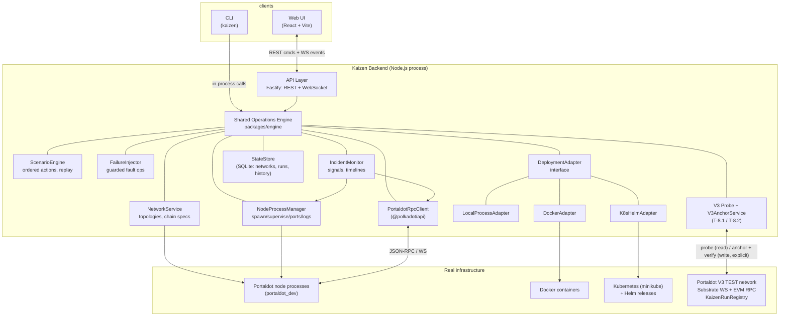
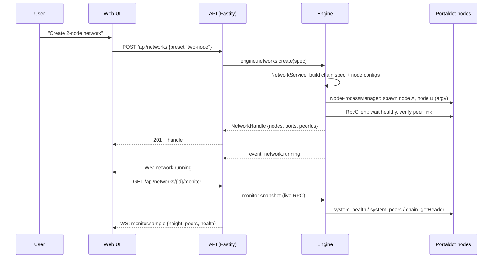
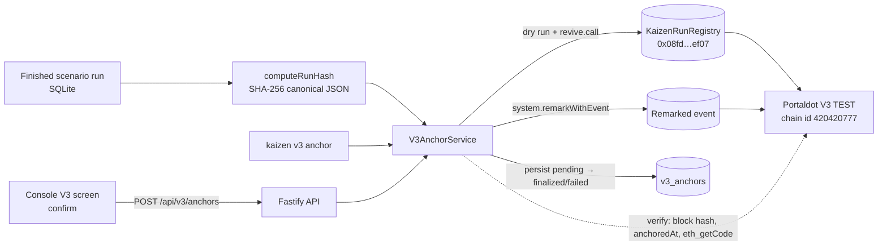
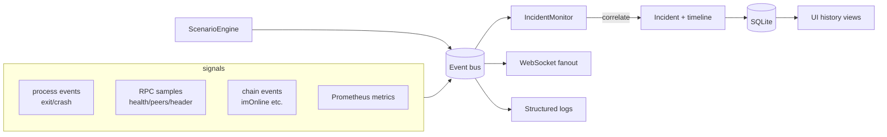

# Kaizen: Architecture

**Status: IMPLEMENTED BASELINE, with explicitly partial and planned components.**
**Revision date: 2026-10-30.** Current state is summarized below; the chronological evidence and limitations are recorded in `docs/PROGRESS.md` and `docs/PHASE_REPORT.md`.

Status legend: **IMPLEMENTED** means the component exists in the repository; **PARTIALLY IMPLEMENTED** means only the described slice exists or verification is incomplete; **PLANNED** means not implemented. Implementation status is not a claim of end-to-end verification.

| Component | Status | Current scope / evidence |
|---|---|---|
| Shared engine, local process/network lifecycle, API and CLI | IMPLEMENTED | Local Portaldot process management, REST/WebSocket API, and shared-engine CLI surfaces. API security scope is localhost-only; see §8. |
| Web console and Failure Lab | PARTIALLY IMPLEMENTED | Console surfaces exist; some controls/features are disabled or replay-labelled. T-3.6C design pass is implemented, not a substitute for live-browser verification. |
| Portaldot V3 probe and run anchoring | IMPLEMENTED | Read-only public V3 probe and explicit signed `KaizenRunRegistry` or remark anchoring paths; historical public transactions are recorded in the phase report. |
| Resilience evidence capture and verification | IMPLEMENTED | Opt-in chain-bound evidence, observer-node heads/hashes, gap detection and online re-fetch verification. Offline evidence may be `unverifiable`. |
| Resilience certificates | IMPLEMENTED | Canonical run/evidence certificate with sr25519 signature and integrity verification. Additional validator/network metadata cross-check hardening is pending separate validation. |
| Resilience scoring v1 | IMPLEMENTED | Deterministic score from eligible certificates; integrity-failing certificates are excluded. Advanced trust model and evidence-class weighting remain planned. |
| `KaizenResilienceRegistry.sol` | PARTIALLY IMPLEMENTED, UNDEPLOYED | Contract/build/codec and in-memory EVM tests exist. It is not deployed; do not describe it as a live registry. Deployment remains blocked until duplicate-fingerprint submission design is resolved. |
| Incident monitor | PLANNED | The UI may show incident/evidence surfaces, but a full incident-monitoring component is not implemented. |
| Docker and Kubernetes/Helm adapters | PLANNED | Adapter interface/local-process path exists; Docker and Kubernetes adapters and deployments are not implemented. |

---

## 1. Design Principles

1. **The backend owns operations.** The web UI never spawns processes, never
   executes shell commands, and never talks to node RPC directly.
2. **One engine, two frontends.** CLI and Web UI call the same application
   services (`packages/engine`). No duplicated network/node/scenario logic.
3. **Adapters at the edges.** Everything external (Portaldot binary, RPC, Docker,
   Kubernetes) sits behind a typed adapter interface, so core logic stays
   testable without live infrastructure.
4. **No fabricated data.** Every number rendered by UI/CLI originates from real
   RPC, real process state, or real recorded history. Unimplemented operations
   are hidden, not faked.
5. **Boring, testable stack.** One language (TypeScript) across engine, API,
   CLI, UI. Modular monolith: no microservices.

## 2. Component Overview



Status (2026-10-30): see the component status matrix at the top of this document. The diagram below shows the intended system shape and is not an implementation checklist; IncidentMonitor and Docker/Kubernetes adapters remain PLANNED, and the resilience registry remains undeployed.

## 3. Component Responsibilities

| Component | Responsibility |
|---|---|
| **Web UI** (`apps/web`) | Operations console (React 19 + Vite + framer-motion; imported design, T-3.6B): Landing, Create, Overview (live topology), node drawer, Validators, Failure Lab, Scenarios, Incidents (fault evidence), Deployments, Portaldot V3, Settings. Thin typed client over the API/WS only (DEC-016): one shared API client for base-URL/errors/timeouts, one WebSocket in a React context (auto-reconnect + resync refetch), `ConsoleProvider` for the selected network (REST state + WS invalidation + bounded monitor poll), engine models via `import type`. Renders only engine-provided data; unbuilt features are disabled and labelled (DEC-028); the browser never launches processes, runs shell commands, or holds signing keys. |
| **CLI (`kaizen`)** | Scriptable surface (human + `--json` output). Thin argument parsing → engine calls. Exit codes for automation. Failure Lab: `scenario (list/get/create/validate/operations)` + `run (execute/replay/list/get/cancel)` over the same engine pathways the API uses; `execute`/`replay` require explicit `--network` (DEC-024). |
| **API Layer** | HTTP for commands/queries; WebSocket for engine event stream. Input validation (Zod), auth-less by design for localhost-first (see §8). |
| **Operations Engine** | The single source of operational truth. Application services with typed inputs/outputs; emits events; persists history. |
| **NetworkService** | Topology presets (data-driven: single/two/four-validator/validator-fullnode + validated custom) → concrete network definitions: chain spec generation, per-node config (base-path, ports, keys, roles, bootnodes), ordered start/stop, per-node start/stop, purge, partial-create rollback. |
| **ChainSpecService** | Per-network spec artifacts: plain spec → typed authority patch (keys derived from the real binary, DEC-011) → `build-spec --raw` rebuild; audit sidecar (`chain-spec.genesis.json`); no-op for topologies whose authorities are already in the stock spec. |
| **MonitoringService** | Polls running networks (one job per network, 2s cadence, in-flight guard): HTTP JSON-RPC sampler → pure health state machine (`unknown/healthy/unhealthy/unavailable/stale`) → typed `monitor.*` events; auto-starts/stops from `network.status` bus events; `snapshotNow()` for on-demand reads (DEC-012/DEC-015). |
| **NodeProcessManager** | Spawns/kills node processes via **argv arrays** (never shell strings), per-node workdirs, log capture, port allocation, health polling, restart policies. |
| **PortaldotRpcClient** | Typed wrapper over `@polkadot/api`: health, peers, sync, headers, events, storage reads. Reconnect/backoff logic. |
| **V3ConnectivityProbe** (`v3/`) | Phase 8 (T-8.1): configuration-driven, read-only connectivity checks of the official Portaldot V3 endpoints: Substrate WS (chain name/health/best header via `readProbeState`), EVM JSON-RPC (validated envelopes + chain-id match against config), explorer HTTP (availability only). Per-endpoint typed results, bounded deadlines, injectable transports (DEC-023); no API/UI surface. |
| **ScenarioEngine** | Loads scenario definitions (ordered actions + delays), executes with recording (action, ts, result, error), supports replay of the action sequence. |
| **FailureInjector** | Executes guarded fault operations (stop, SIGSTOP pause, peer disconnect via reserved-peer RPC or rewire, partition by isolation): only against designated test networks. |
| **IncidentMonitor** | Subscribes to signals (process exit, RPC unreachable, peer count drop, block stall, `imOnline` events), correlates into incidents with timelines + evidence. |
| **DeploymentAdapter** | Uniform interface: `deploy / status / logs / destroy / recover`. Implementations: Local (Phase 1), Docker (Phase 6), K8s/Helm (Phase 6). |
| **StateStore** | SQLite persistence: networks, node configs, scenario definitions, run history, incidents, evidence references. |

## 4. Interfaces & Communication

- **Web ↔ API**: REST for commands (`POST /api/networks`,
  `POST /api/networks/{id}/purge`, `POST /api/nodes/{id}/start|stop`,
  `POST /api/networks/{id}/start|stop|remove`, …) and queries
  (`GET /api/networks/{id}/nodes/{nodeId}`, `GET /api/networks/{id}/monitor`,
  `GET /api/networks/{id}/nodes/{nodeId}/logs`: real log-tail bytes from the
  engine, DEC-016/DEC-017);
  WebSocket `/api/events` for the engine event bus (network lifecycle,
  node lifecycle, typed `monitor.sample` / `monitor.health` / `monitor.peers`
  / `monitor.error`, operation results: every payload carries timestamps and
  ids). Validation via Zod; failures are structured errors with stable codes
  (`INVALID_INPUT` 400, `NETWORK_NOT_FOUND`/`NODE_NOT_FOUND` 404,
  `NETWORK_ALREADY_EXISTS` 409, `NODE_NOT_RUNNING` 409, …).
- **CLI ↔ Engine**: direct in-process imports of `packages/engine` (same
  service objects the API uses). Rationale in DEC-002. Both surfaces call the
  shared engine only: no operation logic is duplicated at either edge.
- **Engine ↔ Nodes**: child processes (local adapter), container control
  (Docker adapter), K8s API + Helm CLI (K8s adapter); node data via RPC.



## 5. Portaldot Integration Boundaries

- **Binary management**: Kaizen downloads/caches `portaldot_dev` + `subkey`
  into `.kaizen/bin/`, records SHA-256 at first fetch (DEC-007). No source
  builds.
- **Node control plane**: purely via CLI flags + signals + subcommands
  (`build-spec`, `purge-chain`, `key insert`): no unsupported internals.
- **Data plane**: JSON-RPC/WebSocket via `@polkadot/api` only. V13 metadata is
  handled by the SDK.
- **Chain interaction policy**: Kaizen never signs mainnet transactions.
  The only external write today is V3 TEST-network run anchoring (T-8.2,
  below); validator write operations (staking/session) are Phase 5,
  guarded, and local-testnet first.
- **V3 external endpoints (Phase 8, T-8.1)**: the official Portaldot V3
  endpoints (`wss://test-node-v3.portaldot.dev`,
  `https://test-evm-rpc-v3.portaldot.dev`,
  `https://node-console.portaldot.dev`, expected EVM chain id 420420777) are
  configuration **defaults** (explicit options / `KAIZEN_V3_*` env override
  them), read-only probe targets only. `V3ConnectivityProbe` never signs,
  never writes, never accepts a caller-supplied URL, and redacts every result
  to origin form (DEC-023); the live check is environment-gated
  (`KAIZEN_TEST_V3=1`) so the offline unit suite is unaffected (RSK-29).
- **V3 run anchoring (Phase 8, T-8.2)**: the ONLY external write path.
  `V3AnchorService` (`packages/engine/src/v3/anchor/`) turns a finished
  scenario run into a deterministic fingerprint (`computeRunHash`: SHA-256
  of the canonical run JSON) and writes it to the V3 TEST network either
  via the `KaizenRunRegistry` contract (`contracts/KaizenRunRegistry.sol`,
  EVM bytecode executed by pallet-revive, `revive.call`) or via
  `system.remarkWithEvent` (DEC-027). Writes are explicit and operator-
  signed from `KAIZEN_V3_SIGNER_SURI` only (DEC-026); a runtime dry run
  precedes every submission; anchor rows are persisted `pending` before
  submission and updated with what the chain reported (SQLite migrations
  19–22: `v3_anchors`, `v3_contracts`). `verify` recomputes the hash and
  re-reads the chain (block hash, registry `anchoredAt`, `eth_getCode`, or
  the remark text). Surfaces: CLI `kaizen v3 probe|status|deploy-registry|
  import-deployment|hash|anchor|anchors|verify`, API `GET /api/v3/probe|
  status|anchors|anchors/:id|runs/:runId/hash`, `POST /api/v3/anchors`
  (`mode:"execute"`), `POST /api/v3/anchors/:id/verify`, WS `v3.anchor` /
  `v3.contract` events, and the console's Portaldot V3 screen. Block links
  use the node console (`https://node-console.portaldot.dev/?rpc=<ws>#/
  explorer/query/<blockHash>`).



## 6. Process & Network Lifecycle

```
NetworkDefinition (preset or validated custom topology)
   → topology validation FIRST (duplicate names/keys, port/path safety,
     stale chain data): before any dir, port, or process is touched
   → ChainSpec per network (plain spec → authority patch with binary-derived
     keys when authorities ⊄ {alice, bob} → build-spec --raw;
     audit sidecar records baked-in authorities)
   → NodeConfig[] (base-path, p2p/rpc/ws/prom ports, role, keys, bootnodes,
     expected_peers = nodeCount − 1)
   → partial-create rollback on any failure (dirs + ports returned, no debris)
   → spawn order: seed/authority node first, then the rest (bootnodes wired)
   → health-gate: each node must reach "synced + peers expected" (with timeout)
   → RUNNING + monitoring auto-attach (bus event) → per-node or full STOP
     (reverse order, SIGTERM→SIGKILL) → STOPPED
   → optional PURGE: refuses while any node is alive, then wipes chain DBs
     (keeps identity/ports/spec) → next start boots from genesis again
```

Failure states are first-class: `DEGRADED` (some nodes down), `UNREACHABLE`
(all RPC lost), `STALLED` (no new blocks > threshold): implemented as the
per-node health machine (`unknown/healthy/unhealthy/unavailable/stale`,
DEC-012). Cleanup always releases ports and records final state.

**Fault injection (`engine.faults`: FailureInjector, T-3.2):** faults
operate on this same lifecycle, never around it, and only ever against
`designatedTest` networks (DEC-008). The injector is a typed service with:

- **Narrow adapters**: one per Phase 3A-verified mechanism (R-22), each
  declaring its type, required privileges, preflight checks, bounded
  execution, expected observable effect, verification method, timeout
  behaviour, cleanup, and failure semantics. Implemented today: `pause`
  (SIGSTOP/SIGCONT on a re-verified managed PID: R-22 A) and `terminate`
  (engine stopNode/startNode with a NEW pid: R-22 D). `peer-disconnect`
  and `partition` are registered as explicit BLOCKED adapters: they fail
  with typed unsupported results naming the precise unblock path (e.g.
  reserved-only topology wiring, DEC-018 operator authorization) and NEVER
  substitute a mechanism proven ineffective (plain reserved-peer RPC,
  proxy-only cuts, static port firewall rules: R-22 negatives).
- **Safety boundary**: every request is revalidated with fresh reads at
  execution time: designatedTest + local chain, node ∈ network, engine-
  managed running process, stable identity (pid + `kaizen-node.pid`
  agreement: a reused PID or ambiguous process is refused, never
  signalled), one active fault per node, quarantine check. Dry-run is the
  default surface; `execute()` is a separate explicit action (over REST it
  additionally demands a literal `mode:"execute"` body marker). Privileged
  (sudo-level) faults are deliberately NOT implemented: the engine never
  escalates privileges or touches host firewall state (DEC-018).
- **Lifecycle & audit**: `requested → validating → (rejected | ready →
  executing → verifying → cleaning-up → completed | failed | cancelled |
  cleanup-failed)`; illegal transitions are refused, every transition is
  persisted to the SQLite `faults` table and emitted as a `fault.state`
  event. Accepted, rejected, executed, verified, and cleaned-up requests
  are all recorded with actor, target, plan, and structured evidence.
- **Verification discipline**: command-accepted, mechanism-applied,
  effect-observed, fault-removed, recovered, and recovery-verified are
  separate claims in the result (never one collapsed "success" flag),
  backed by bounded polling against the node's own RPC and the process
  table (e.g. pause = RPC unreachable WHILE pid alive; restart = NEW pid
  answering RPC). Cleanup runs on completion, error, timeout, and
  cancellation paths; if rollback cannot be proven the fault is marked
  `cleanup-failed`, a high-severity `fault.cleanup-failed` event is
  emitted, and the target is quarantined until `reconcile()` proves the
  effect is gone. `engine.close()` cancels in-flight faults and resumes
  paused processes: no stopped process outlives the engine.

Kernel-level isolation (port/cgroup firewall rules or a per-node netns +
veth) remains an operator-authorized fallback under DEC-018: narrow scope
to one process/link on both IP families, no interface scoping, no
FORWARD/DOCKER chains, no host-global firewall changes, with the pre/post
baseline captured and byte-identical rollback verified on every exit path.
A partition claim is only valid with evidence from the unaffected nodes
too (peer sets, `ss`, head/finality progression): never from the
target's silence alone.

**Scenario authoring (`engine.scenarios`: ScenarioService, T-3.3):**
scenarios are reusable, validated *data*: ordered steps with typed
operations, bounded delays/timeouts, typed pre/postconditions, and explicit
failure/cancellation semantics, persisted in the SQLite `scenarios` table.
Key properties:

- **Safe operation registry**: built at runtime from the injector's
  `describeMechanisms()` (single source of truth), so the authoring view
  can never contradict what the injector supports: `pause`/`terminate`
  show as supported mechanisms, `peer-disconnect`/`partition` stay BLOCKED
  with their unblock paths verbatim, `node-restart` is listed as planned.
  The registry is descriptive only: it never bypasses runtime safety;
  execution (T-3.4 ScenarioEngine) still revalidates through the
  injector's preflight/gates. There is no arbitrary shell/signal/firewall
  surface: configs are strict schema-validated objects targeting node
  labels within a designated-test topology.
- **Deterministic validation**: pure (no clock, no store, no UI), the
  same input + registry yields a byte-identical structured
  `ScenarioValidationResult` (stable codes, severity, field path, message,
  remediation). It catches unknown/blocked/planned operations, invalid
  configs, missing fault preconditions, contradictory or impossible
  conditions, ordering mistakes, out-of-bounds delays/timeouts, pause
  holds that don't fit their step budget, excessive worst-case duration,
  safety violations (designatedTest=false is never allowed), capability
  and preset/node-label mismatches, and secret-shaped content. Conditions
  the architecture cannot evaluate yet (`finality-progress`,
  `runtime-event`) are represented with evaluability `planned` and
  REJECTED by validation: never pretended to be checkable.
- **Failure/cancellation semantics are data**: precondition-fail,
  step-fail, inconclusive verification, step timeout, and cleanup-failure
  are explicit enums persisted on the scenario (today the legal values
  are `abort-run|continue|cancel-run`, `fail-step|warn-and-continue`, and
  the fixed safe `cancel-run`/`cleanup-then-stop` pair). Skipping steps is
  only representable via `onPreconditionFailed: 'skip-step'`. The
  executor (T-3.4) implements these semantics; the service itself has NO
  execution path: CRUD and validate-only endpoints never run anything,
  and a saved scenario never auto-executes.
- **Persistence & audit**: validated definitions (including their
  validation result and `valid|warning` status) round-trip across
  restarts; rows with newer schema versions or corrupt JSON are surfaced
  as structured per-row entries (`SCENARIO_VERSION_UNSUPPORTED` /
  `SCENARIO_MALFORMED`), never silently dropped. Authoring mutations emit
  `scenario.created|updated|deleted` audit events.

**Scenario execution (`engine.scenarioRuns`: ScenarioEngine, T-3.4):**
runs are explicit, sequential, and fully recorded. Key properties:

- **Explicit request, never automatic**: a saved scenario never executes
  by itself; only `execute({ scenarioId, networkIdOrName, mode:
  'execute' })` (API: `POST /api/scenarios/:id/execute`, DEC-021) starts
  a run, and CRUD/validate/loading/viewing never touch the injector.
  Each run persists an **immutable snapshot** of the definition (later
  authoring edits cannot change a running or historical run) and resolved
  target nodes; run/step records live in SQLite tables
  `scenario_runs`/`scenario_run_steps` (schemaVersion 15, migration 11),
  transitions are atomic through the store's single writer, and evidence
  is redacted: no secrets are ever stored in run records.
- **Fail-closed pre-execution gates**: before a run may leave
  `validating`, the engine enforces, with fresh reads and in order: (1)
  revalidation of the stored definition (RSK-28), (2) operation support
  right now (blocked/planned refused), (3) exact target resolution, (4)
  DEC-008 safety posture re-checked (`designatedTest`, chain scope,
  preset match, `minNodes`, capabilities), (5) label→managed-node
  resolution for every operation and condition target, (6) quarantine
  (unreconciled cleanup failure blocks conflicting runs), (7) conflict
  checks (no concurrent run per target/scenario, no active fault on a
  target node). A refusal persists a `rejected` run with its structured
  gate error FIRST, then throws: audit without execution.
- **Ordered per-step pipeline**: persist `running` → bounded,
  cancel-aware delays → preconditions (independent RPC/process/health
  observations, honest `satisfied`/`not-satisfied`/`inconclusive`
  verdicts with per-condition budgets) → failure policy → injector
  `preflight` → `injector.execute` (the ONLY fault path: there is no
  bypass) → record result + evidence → postconditions → verification →
  cleanup check → persist. States are typed (13 run / 11 step states)
  with legal-transition maps enforced on every write; events
  (`scenario-run.created|state|step|verification|cancelled|cleanup-failed|
  finished`) mirror every transition.
- **Failure policies are data, re-validated at run time** :
  `onPreconditionFailed: abort-run|skip-step|cancel-run`,
  `onStepFailed: abort-run|continue|cancel-run`,
  `onVerificationInconclusive: fail-step|warn-and-continue`,
  `onStepTimeout: fail-step|cancel-run`, `onCleanupFailed: cancel-run`
  (fixed). `continue` after a failure additionally requires PROOF the
  target is safe (no active fault, no unreconciled quarantine, no
  contradicting claims): otherwise the run fails closed. Cleanup
  failure always ends `cleanup-failed`: target quarantined + high-severity
  event, never claimed as recovered.
- **Cancellation, timeout, cleanup**: explicit `cancel(runId)` (API
  route) is persisted as `cancel-requested` before anything is
  interrupted; interruption happens ONLY via `injector.cancel` inside a
  bounded wait; the cleanup path runs on every finish path with a bounded
  wait, and unconfirmed cleanup degrades to `cleanup-failed` +
  quarantine. Step/run deadlines report `STEP_TIMEOUT` honestly (an
  exhausted condition budget is never fabricated into a verdict).
- **Durability & crash reconciliation**: history survives restarts
  (paginated `listScenarioRuns` with per-row `SCENARIO_RUN_MALFORMED`
  entries); on startup `reconcileOnStartup()` (idempotent) terminalizes
  unfinished runs as `INTERRUPTED` (never resumes them), reconciles
  stuck execute-mode faults (SIGCONT sweep → quarantine when not
  provable → `reconcile()` only on evidence), and leaves dry-run records
  alone; `engine.close()` cancels in-flight faults before shutting the
  injector down.

**Scenario replay (`engine.scenarioRuns.replay`: T-3.5, DEC-022):**
a replay re-executes a finished run's recorded actions as a NEW run
(API: `POST /api/scenarios/runs/:runId/replay`). Key properties:

- **One executor, snapshot-sourced**: replay re-enters the exact same
  run-start path as `execute()` (same gate chain → same injector →
  same evidence pipeline; there is no second executor anywhere). The
  new run executes the SOURCE run's immutable `snapshot`: never the
  scenario's current (possibly edited or deleted) definition: and if
  the snapshot cannot be used (missing/empty steps) the replay is
  refused with `SCENARIO_RUN_NOT_REPLAYABLE` before any run record
  exists.
- **Explicit target, explicit marker: provenance is not
  authorization**: the replay request carries its own `mode:
  'execute'` and its own `networkIdOrName`; a target is never inherited
  from the source run. Every gate is re-evaluated with CURRENT state
  (fresh definition revalidation against the CURRENT registry,
  operation support, DEC-008 target posture, label resolution,
  quarantine, conflicts): an operation that succeeded in the source run
  earns nothing.
- **Eligible sources**: terminal execution states only:
  `completed`, `completed-with-warnings`, `failed`, `cancelled`,
  `cleanup-failed` (`rejected` never executed an action → use
  `execute()`; unfinished states are never resumed or replayed).
  Refusals happen BEFORE any run record exists for source problems, or
  persist a `rejected` replay run (with provenance) for gate problems :
  same audit posture as `execute()`.
- **Provenance, append-only**: `replayOfRunId` (nullable) on the run
  record and summary, stored in `scenario_runs.replay_of_run_id`
  (schemaVersion 17, migration 12, indexed); the source run row is
  never rewritten; `GET /api/scenarios/runs?replayOf=<runId>` queries
  every replay attempt from a source. A clean replay reaches plain
  `completed`: replay honesty is carried by `replayOfRunId` and the
  explicit `replayNote` in the 202 response ("repeats the recorded
  actions; identical outcomes are NOT guaranteed; evidence was freshly
  observed"), not by degrading the state via `warnings`.
- **Fresh everything**: replay steps get new step records, new fault
  ids, and new evidence; no source-run evidence is ever copied. A
  blocked replay reports why it was blocked (persisted rejection), and
  timeout/inconclusive/cleanup-failed/quarantine semantics are the
  executor's, unchanged.

## 7. Data & Event Flow (monitoring)



## 8. Security Boundaries

- **Command execution**: engine spawns with argv arrays only; no string shells;
  no user-controlled flags passthrough without allowlist validation.
- **Input validation**: all API/CLI inputs validated with Zod schemas at the
  boundary; unknown fields rejected.
- **Network exposure**: node RPC stays on loopback; `apps/api/src/server.ts`
  binds to `127.0.0.1` by default. The localhost API is unauthenticated by
  design because it is intended for local-only use. It is not suitable for
  remote deployment as-is. Before any remote deployment, implement and verify
  origin validation (Host/Origin checks and WebSocket cross-origin protection)
  plus an appropriate authentication boundary. Keep this warning visible until
  those controls are implemented and tested.
- **Secrets**: node keys/keystore material live in per-network dirs outside
  git (`.kaizen/` in `.gitignore`); never logged, never returned via API.
- **Blast-radius gate**: failure injection and any destructive op require the
  target network to carry `designatedTest: true`; chain must be Local/
  Development type (FR-5, DEC-008). The FailureInjector enforces this with
  fresh reads at execution time, refuses targets whose managed-process
  identity is ambiguous, and exposes no generic command/signal/executable
  surface: only typed fault methods on registered disposable networks
  (T-3.2; privileged faults are not implemented, DEC-018).
- **Supply chain**: upstream binaries carry no signatures; we record hashes
  TOFU and surface them in the UI (RSK-07).

## 9. Deployment Adapters

| Adapter | Mechanism | Phase |
|---|---|---|
| LocalProcess | child_process argv spawn (same as dev engine) | 1, IMPLEMENTED |
| Docker | image with `portaldot_dev`; compose-style multi-node; volume per node | 6, PLANNED |
| K8s/Helm | Helm chart: StatefulSet per node role, PVCs, Services, headless service for peering, readiness probes from RPC health | 6, PLANNED |

All adapters implement:
```ts
interface DeploymentAdapter {
  deploy(def: NetworkDefinition): Promise<DeploymentHandle>;
  status(handle): Promise<DeploymentStatus>;   // real health, not assumptions
  logs(handle, opts): AsyncIterable<LogLine>;
  destroy(handle): Promise<void>;
  recover(handle, action): Promise<RecoveryResult>;
}
```

## 10. Stack Recommendation (DEC-001 justification)

| Layer | Choice | Why |
|---|---|---|
| Language | TypeScript on Node.js 24 | One language for engine/API/CLI/UI; installed and verified here; strong typing for typed interfaces (FR-3); best-in-class Substrate client `@polkadot/api` (V13-compatible). |
| API | Fastify + Zod | Fast, schema-first validation, first-class WebSocket plugin. |
| Realtime | WebSocket (ws via `@fastify/websocket`) | Engine event fanout; no extra infra. |
| RPC client | `@polkadot/api` | Canonical Substrate RPC/metadata handling; avoids hand-rolled SCALE. |
| Frontend | React + Vite | Fast dev loop, rich ecosystem; fits the "real dashboard" wow-factor. |
| Storage | SQLite (`better-sqlite3`) | Zero-infra persistence for networks/runs/history; single file, easy backup. |
| CLI | commander + shared engine | Thin layer; `--json` mode for automation. |
| Containers/K8s | docker CLI via argv; Helm CLI via argv; minikube | All present in env (Docker 29.8, kubectl 1.37, Helm 4.3, minikube). |
| Tests | vitest (unit/integration) + Playwright (e2e, later) | Same toolchain, fast, TS-native. |

**Alternatives considered** (see DEC-001 for the decision record):
- *Python backend*: official SDK exists, but `substrate-interface` has a
  documented signing bug on Portaldot V13 (R-16) and would split the stack.
- *Go backend*: no mature Substrate client; would require hand-rolled SCALE
  codec: unjustified risk.
- *Microservices*: rejected; a modular monolith runs everywhere and keeps
  operations atomic (project constraint).

## 11. Repository Layout (target)

```
kaizen/
  AGENTS.md                 governance for agents
  README.md
  docs/                     this documentation set
  package.json              npm workspaces root
  packages/
    engine/                 the shared operations engine
    cli/                    kaizen CLI
  apps/
    api/                    Fastify REST + WS server
    web/                    React UI
  charts/
    portaldot/              Helm chart (Phase 6)
  test/                     cross-package integration/e2e tests
  .kaizen/                  runtime state (gitignored): bins, networks, db
```

## 12. Open Architecture Questions

1. WS RPC client compatibility with this node build (T-1.5 resolves).
2. Genesis authority set of Local Testnet → topology preset design (T-2.1).
3. Partition simulation mechanism on a single host (T-3.1 evaluates
   reserved-peer RPC vs process isolation vs port rewiring).
4. Helm v4 vs v3 chart compatibility on the installed client (T-6.3).
5. minikube resource envelope for 4-node networks on 2 vCPU (T-6.4).
